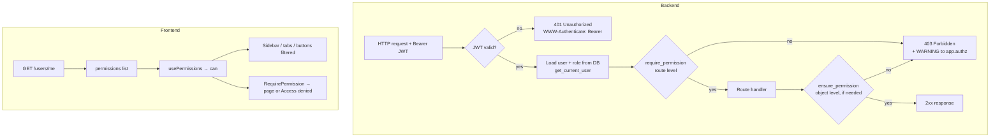
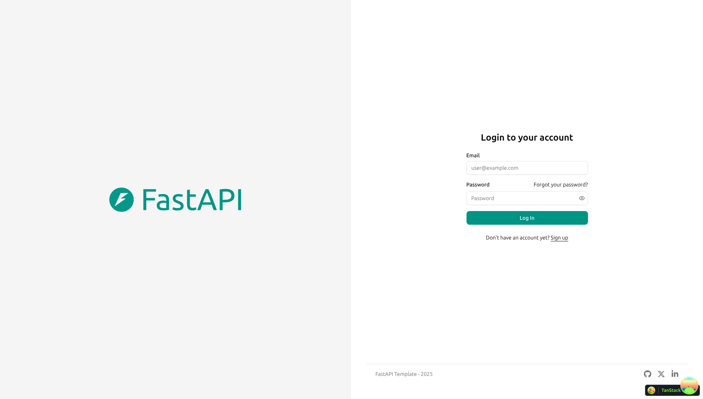
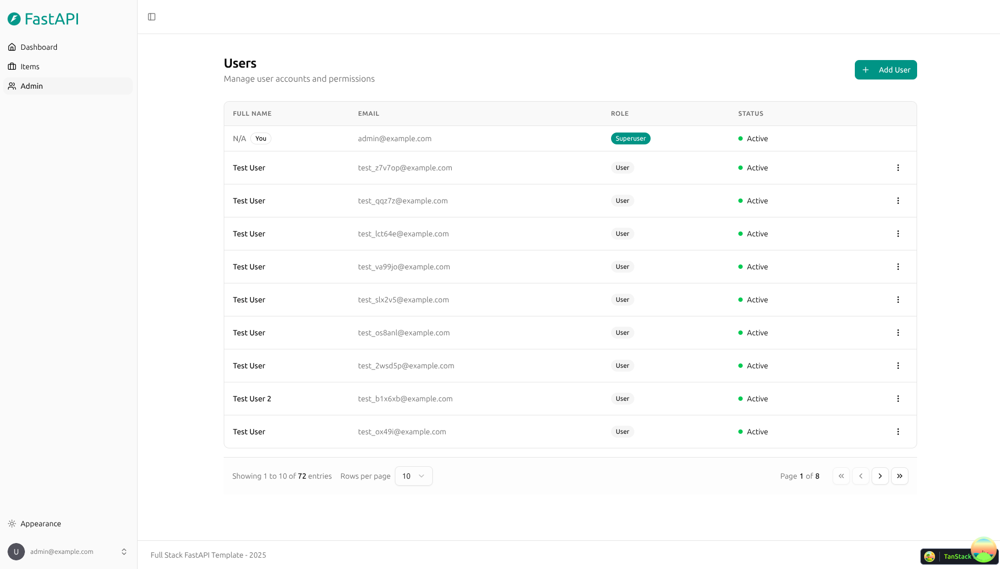
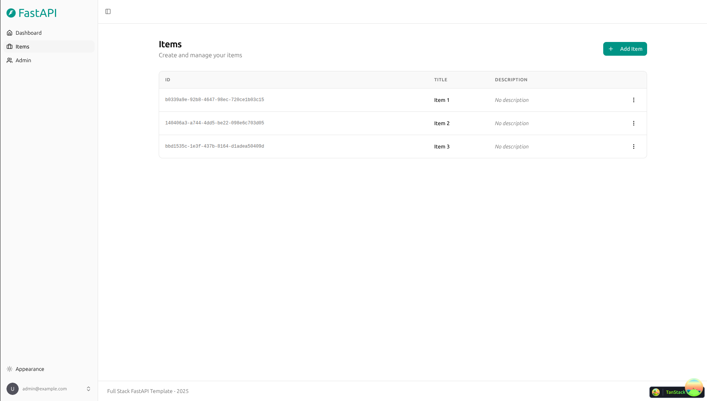
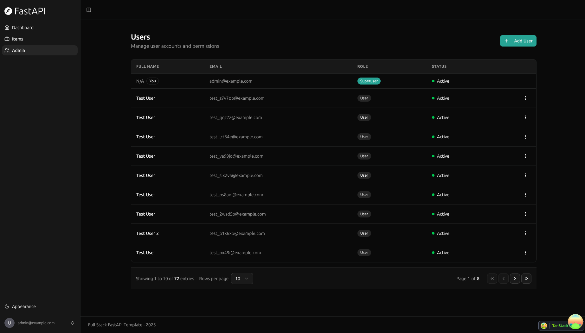
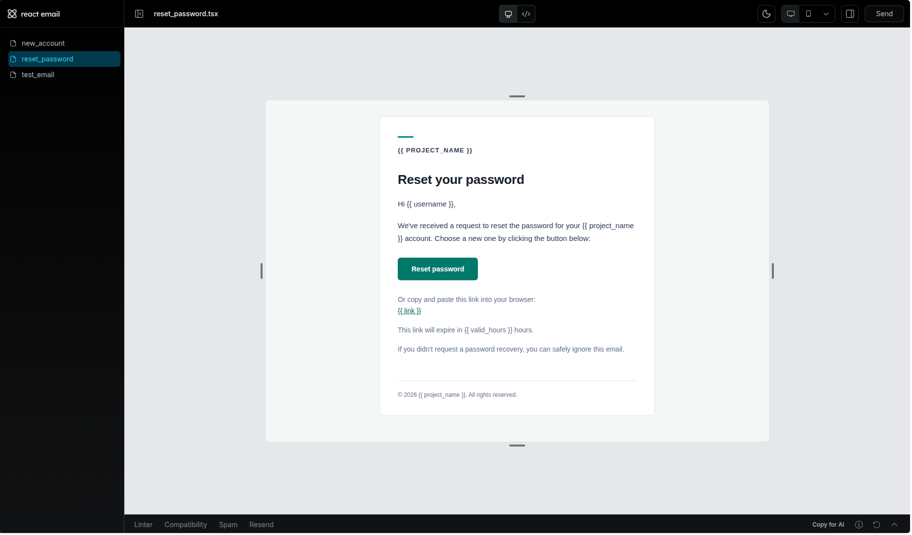
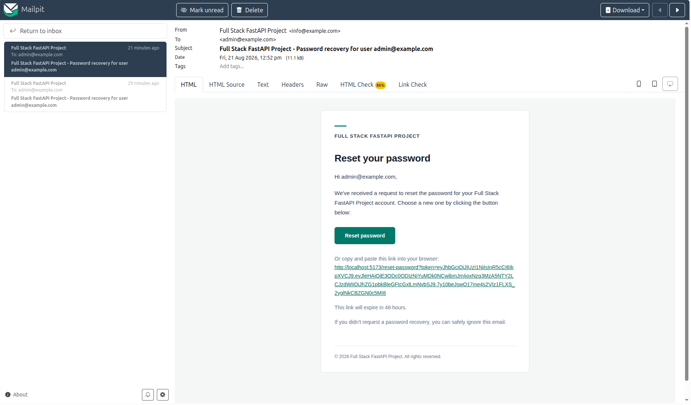
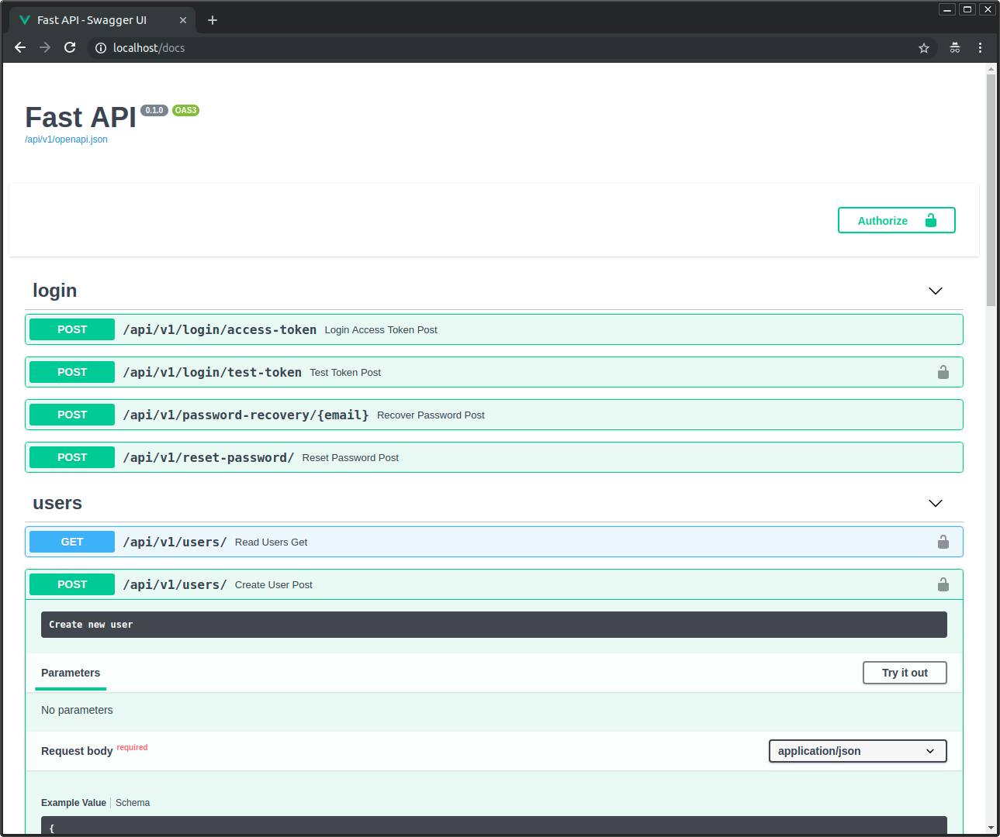

# Task 1 — RBAC for the Full Stack FastAPI Template

Role-based access control with three roles — **admin**, **manager**, **member** — enforced in the FastAPI backend and reflected in the React frontend.

Based on [full-stack-fastapi-template](https://github.com/fastapi/full-stack-fastapi-template) @ [`aabb901`](https://github.com/fastapi/full-stack-fastapi-template/commit/aabb90126964a164e02aff39e7c385bb0598236d) (branch `master`). The first commit of this repository is the unmodified template, so `git diff <first commit>..HEAD -- task1-rbac` shows only the RBAC changes. The original template README is kept [below](#full-stack-fastapi-template).

**Contents:** [Quick start](#quick-start) · [Permission matrix](#permission-matrix) · [How authorization works](#how-authorization-works) · [Adding a new role](#adding-a-new-role) · [Running tests](#running-tests) · [Database migration](#database-migration) · [ADRs and notes](#decisions-and-notes)

## Quick start

Prerequisites: [Docker](https://docs.docker.com/get-docker/) with Compose, [uv](https://docs.astral.sh/uv/), [bun](https://bun.sh/). Ports 5432, 8000, 5173, 8025 and 1025 must be free.

The repository ships a `.env` with local-development defaults (`changethis` placeholders, `FASTAPI_ENV=development`); it works as-is for local use. Never put real secrets in it.

```bash
cd task1-rbac
docker compose up -d --wait db mailpit   # PostgreSQL + Mailpit (http://localhost:8025)

cd backend
uv sync
uv run bash scripts/prestart.sh          # applies migrations, creates the admin (FIRST_SUPERUSER)
uv run python -m app.seed_demo_users     # creates the manager and member demo users
uv run fastapi dev                       # API on http://localhost:8000, docs at /docs
```

In a second terminal:

```bash
cd task1-rbac
bun install
bun run dev                              # frontend on http://localhost:5173
```

### Demo users

| Role    | Email               | Password            | Comes from |
|---------|---------------------|---------------------|------------|
| admin   | `admin@example.com` | `changethis`        | `FIRST_SUPERUSER` / `FIRST_SUPERUSER_PASSWORD` in `.env` |
| manager | `manager@example.com` | `manager-demo-pass` | seed script, override with `DEMO_MANAGER_PASSWORD` |
| member  | `member@example.com`  | `member-demo-pass`  | seed script, override with `DEMO_MEMBER_PASSWORD` |

These passwords are for local development only. The seed script is idempotent (existing emails are skipped) and refuses to run unless `FASTAPI_ENV=development`. The env var names `FIRST_SUPERUSER*` are kept from the template for compatibility; that user is created with `role=admin`.

## Permission matrix

Code checks **permissions**, never role names. A role is a named set of permissions, defined once in [`ROLE_PERMISSIONS`](backend/app/core/permissions.py).

| Permission           | Allows                                                                                  | admin | manager | member |
|----------------------|-----------------------------------------------------------------------------------------|:-----:|:-------:|:------:|
| *(none needed)*      | view / update own profile, change own password, CRUD own items                          | ✓ | ✓ | ✓ |
| `users:read`         | list all users (`GET /users/`), view any user (`GET /users/{id}`)                       | ✓ | ✓ | ✗ |
| `metrics:view`       | metrics page (`GET /metrics/`)                                                          | ✓ | ✓ | ✗ |
| `users:create`       | create users (`POST /users/`)                                                           | ✓ | ✗ | ✗ |
| `users:manage`       | update / delete any user, assign roles, password-recovery HTML preview                  | ✓ | ✗ | ✗ |
| `items:manage_any`   | list all items (`GET /items/`), read / update / delete other users' items              | ✓ | ✗ | ✗ |
| `settings:manage`    | system utilities (`POST /utils/test-email/`)                                            | ✓ | ✗ | ✗ |
| `account:delete_own` | delete own account (`DELETE /users/me`)                                                 | ✗ | ✓ | ✓ |

Rules on top of the matrix:

- Public signup (`POST /users/signup`) always creates a **member**; a `role` in the body is ignored. The same applies to `PATCH /users/me`.
- An admin cannot demote or deactivate **themselves** (`409 Conflict`). Every user-management action leaves the acting admin in place, so the API can never leave the system without an admin.
- Admins cannot delete their own account (they lack `account:delete_own`), whichever endpoint they use.
- Creating a user with a role other than `member` also requires `users:manage` (role assignment).

## How authorization works

**Where checks live.** All checks are FastAPI dependencies in [`app/api/deps.py`](backend/app/api/deps.py). Route-level checks are declared on the route — `dependencies=[Depends(require_permission(Permission.USERS_READ))]` — so the required permission is visible next to the endpoint. Checks that depend on the data ("own item, or `items:manage_any`"; "own profile, or `users:read`") call `ensure_permission(request, user, permission)` inside the handler. Both paths raise the same `403 {"detail": "The user doesn't have enough privileges"}` and log a `WARNING` to the `app.authz` logger with user id, role, permission, method and path. No other code raises 403.

**How roles are stored and validated.** `user.role` is a `VARCHAR(20)` column (not a native Postgres enum, so adding a role needs no schema migration), mapped to the Python `Role` enum: invalid values are rejected at the API boundary (422) and unknown values in the database fail loudly instead of granting anything. `is_superuser` was removed entirely, so there is a single source of truth. Permissions are never stored: they are derived from the role in code ([`app/core/permissions.py`](backend/app/core/permissions.py)). The JWT contains only the user id; the user and role are loaded from the database on every request, so a role change applies immediately, even to tokens already issued. Users cannot change their own role: the self-update and signup schemas have no `role` field.

**How the frontend learns capabilities.** `GET /api/v1/users/me` returns the user plus `permissions`, computed by the backend. The [`usePermissions()`](frontend/src/hooks/usePermissions.ts) hook exposes `can(permission)`; the sidebar and settings tabs declare an optional `permission` and are filtered with it, buttons such as "Add User" use it directly, and [`<RequirePermission>`](frontend/src/components/Common/RequirePermission.tsx) renders an *Access denied* card on direct navigation to a page the user cannot open. The frontend has no role → permission mapping; role names appear only in display code (labels, the role badge, the role select and its `member` default), never in access decisions. Hiding UI is UX only — the API is the enforcement point.

**401 vs 403.** A missing, invalid or expired token returns `401` with `WWW-Authenticate: Bearer`; the frontend then logs the user out. An authenticated user without the permission gets `403`; the frontend shows a "You don't have permission to do that" toast, keeps the session and refetches `/users/me` in case the role has changed. (The template logged users out on both and returned 403 for bad tokens.)



## Adding a new role

1. Add it to `Role` in [`backend/app/core/permissions.py`](backend/app/core/permissions.py).
2. Add its permission set to `ROLE_PERMISSIONS` in the same file.

No migration is needed. Then regenerate the frontend client (`bash scripts/generate-client.sh` from `task1-rbac/`); the TypeScript build will point you to [`frontend/src/lib/roles.ts`](frontend/src/lib/roles.ts) to add the display label. The table-driven test denies the new role everywhere by default, and `test_read_me_returns_permissions_of_role` asks you to state its permissions explicitly.

A new **permission** additionally needs `require_permission(...)` / `ensure_permission(...)` on the endpoints it protects and `can(...)` where the UI should react to it.

## Running tests

From `task1-rbac/backend`, with the database running:

```bash
uv run bash scripts/test.sh                              # full suite with coverage
FASTAPI_ENV=development uv run pytest tests/api/routes/test_rbac.py -v   # RBAC tests only
```

`FASTAPI_ENV=development` must be set in the shell when calling pytest directly (as `scripts/test.sh` does): without it FastAPI refuses to start when the built frontend (`backend/app/frontend`) is missing.

`test_rbac.py` contains a table-driven permission matrix (every permission-protected endpoint, plus own-data endpoints, × admin / manager / member / anonymous, with ids such as `member-cannot-list-users`), explicit privilege-escalation tests, 401 vs 403 checks and a check that denied attempts are logged.

The template's test fixture deletes all users and items when the session ends, so after running tests re-create the demo users with `uv run python -m app.seed_demo_users` (it also re-creates the admin).

End-to-end tests (Playwright, need the backend and `bunx playwright install chromium` once): `cd task1-rbac/frontend && bunx playwright test`.

## Database migration

[`f08a9279456f_replace_is_superuser_with_role`](backend/app/alembic/versions/f08a9279456f_replace_is_superuser_with_role.py):

- adds `user.role VARCHAR(20) NOT NULL DEFAULT 'member'`,
- sets `role = 'admin'` where `is_superuser` was true,
- drops `is_superuser`.

It is applied by `scripts/prestart.sh` (`alembic upgrade head`). Roll back with `uv run alembic downgrade -1`: `is_superuser` is restored as `true` for admins; managers and members both become regular users, because the old schema cannot represent them. After a downgrade → upgrade round trip they all come back as `member`, so re-assign the manager role (e.g. as admin on the Admin page); the seed script skips existing emails and will not do it.

## Decisions and notes

- [ADR 0001 — Permission-based RBAC](docs/adr/0001-permission-based-rbac.md)
- [ADR 0002 — Frontend capabilities from the API](docs/adr/0002-frontend-capabilities-from-api.md)
- [NOTES.md](NOTES.md) — time spent, scope cuts, known limitations, next steps

---

# Full Stack FastAPI Template

[](../../actions/workflows/test-docker-compose.yml)
[](../../actions/workflows/test-backend.yml)

## Technology Stack and Features

- ⚡ [**FastAPI**](https://fastapi.tiangolo.com) for the Python backend API.
  - 🧰 [SQLModel](https://sqlmodel.tiangolo.com) for the Python SQL database interactions (ORM).
  - 🔍 [Pydantic](https://docs.pydantic.dev), used by FastAPI, for the data validation and settings management.
  - 💾 [PostgreSQL](https://www.postgresql.org) as the SQL database.
- 🚀 [React](https://react.dev) for the frontend.
  - 🧩 Built into the backend application and served by FastAPI on the same domain as the API.
  - 💃 Using TypeScript, hooks, [Vite](https://vitejs.dev), and other parts of a modern frontend stack.
  - 🎨 [Tailwind CSS](https://tailwindcss.com) and [shadcn/ui](https://ui.shadcn.com) for the frontend components.
  - 🤖 An automatically generated frontend client.
  - 🧪 [Playwright](https://playwright.dev) for end-to-end testing.
  - 🦇 Dark mode support.
- ☁️ [FastAPI Cloud](https://fastapicloud.com) for deployment.
- 🐋 [Docker Compose](https://www.docker.com) for local services and self-hosted deployment.
  - 📞 [Traefik](https://traefik.io) as a reverse proxy with automatic HTTPS.
- 🔒 Secure password hashing by default.
- 🔑 JWT (JSON Web Token) authentication.
- 📫 Email-based password recovery.
- ✉️ [React Email](https://react.email) for email templates.
- 📬 [Mailpit](https://mailpit.axllent.org) for local email testing during development.
- ✅ Tests with [Pytest](https://pytest.org).
- 🏭 CI (continuous integration) and CD (continuous deployment) based on GitHub Actions.

### Dashboard Login



### Dashboard - Admin



### Dashboard - Items



### Dashboard - Dark Mode



### React Email Templates



### Mailpit - Local Email Testing



### Interactive API Documentation



## How to Use It

Click the **Use this template** button at the top of this page to create a new repository.

## Backend Development

Backend docs: [backend/README.md](./backend/README.md).

## Frontend Development

Frontend docs: [frontend/README.md](./frontend/README.md).

## Deployment

FastAPI Cloud deployment: [deployment.md](./deployment.md).

Self-hosted deployment with Docker Compose: [deployment-docker-compose.md](./deployment-docker-compose.md).

## Development

General development docs: [development.md](./development.md).

This includes the local FastAPI and Vite workflow, Docker Compose services, `.env` configuration, and more.

## Release Notes

Check the file [release-notes.md](./release-notes.md).

## License

The Full Stack FastAPI Template is licensed under the terms of the MIT license.
