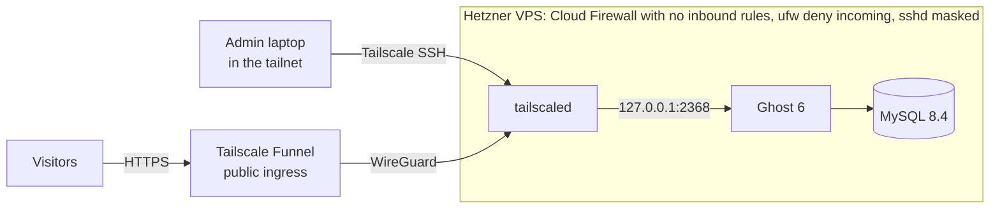

# Task 2 — One-click Ghost on Hetzner without public SSH

`./deploy.sh` creates a Hetzner Cloud VPS that has **no open inbound ports** and runs Ghost on it. Visitors reach the blog through **Tailscale Funnel**. Admins get a shell only through **Tailscale SSH** from the tailnet. Both are tunnels the server opens itself, as outbound connections.

> **Verification status.** I could not register a Hetzner account, so the Hetzner path (`./deploy.sh`) has **not been run against the real Hetzner API**. Everything that happens on the server was verified end to end with `./deploy.sh --local`. That mode boots the same Ubuntu 24.04 cloud image with the same `cloud-init.yaml` in a local Multipass VM and goes through the real Tailscale tunnels. See [Verification](#verification).

## Quick start: run it locally (no Hetzner account needed)

1. Install the tools: `brew install jq gettext && brew install --cask multipass`. Log in to your tailnet on this machine with the [Tailscale client](https://tailscale.com/download).
2. In the Tailscale admin console:
   - enable MagicDNS and HTTPS certificates;
   - add the [policy snippet](#prerequisites) (`tag:ghost`, Funnel, SSH);
   - generate an auth key: **reusable, ephemeral, tag `tag:ghost`**.
3. Configure:
   ```bash
   cd task2-ghost-hetzner
   cp .env.example .env    # set TS_AUTHKEY and TS_TAILNET_DNS; HCLOUD_TOKEN is not needed locally
   ```
4. Deploy and verify:
   ```bash
   ./deploy.sh --local     # ends with "PASS all checks passed" and prints the URLs
   ```
5. Open `https://ghost-blog.<your-tailnet>.ts.net`. The admin panel is at `/ghost`; run `cat .ghost-admin-credentials` for the login.
6. Tear down:
   ```bash
   ./destroy.sh --local    # leaves the tailnet and deletes the VM
   ```

**To deploy again,** run `./deploy.sh --local` after `./destroy.sh --local`. A reusable key works for every run until it expires. If a VM was deleted any other way, first remove the `ghost-blog` device in the Tailscale admin console.

**On Hetzner,** set `HCLOUD_TOKEN` in `.env`, use a single-use, non-ephemeral key, and run `./deploy.sh` / `./destroy.sh` without `--local`.

## Architecture



The server dials out to Tailscale, so nothing has to listen on its public IP. Four layers keep it that way:

| Layer | What it does |
|---|---|
| Hetzner Cloud Firewall (`<name>-deny-inbound`) | No inbound rules, so Hetzner drops every inbound packet before it reaches the VM |
| `ufw default deny incoming` | Same rule inside the VM, in case the server is ever detached from the firewall |
| `systemctl mask ssh.socket ssh.service` | There is no SSH daemon to reach, even from inside the network |
| Ghost published on `127.0.0.1:2368` only | Ghost is reachable only through `tailscaled` (Funnel / tailnet) |

## Files

| File | Purpose |
|---|---|
| [`deploy.sh`](deploy.sh) | The one click. It checks prerequisites, renders cloud-init, creates the firewall and the server (or the local VM), waits for the tailnet and for Ghost, creates the Ghost owner account, then runs `verify.sh` |
| [`cloud-init.yaml`](cloud-init.yaml) | Server bootstrap. Order: lock down inbound traffic → join the tailnet with `--ssh` → start Ghost + MySQL with Docker Compose → `tailscale funnel` |
| [`verify.sh`](verify.sh) | Checks the deployed server against the requirements. Safe to re-run |
| [`destroy.sh`](destroy.sh) | Logs the server out of the tailnet and deletes the server and firewall (or the VM) |
| [`lib.sh`](lib.sh) | Shared helpers (argument parsing, `.env` loading, checks) |
| [`.env.example`](.env.example) | Configuration template |

## Prerequisites

**Local tools.** The scripts are tested on macOS and should also work on Linux.

```bash
# macOS
brew install hcloud jq gettext            # gettext provides envsubst; curl, nc, dig, openssl ship with macOS
brew install --cask multipass             # only for ./deploy.sh --local
# Debian/Ubuntu
sudo apt install jq gettext-base netcat-openbsd dnsutils curl openssl   # + hcloud from https://github.com/hetznercloud/cli/releases
```

You also need the [Tailscale client](https://tailscale.com/download), logged in to your tailnet on this machine.

**Hetzner.** A Cloud project and an API token with Read & Write access (Console → project → Security → API tokens).

**Tailscale** (admin console):

1. **DNS**: enable MagicDNS and HTTPS certificates.
2. **Access controls**: add a tag that may use Funnel, plus an SSH rule for it. If `nodeAttrs` / `ssh` already exist, merge into them:
   ```jsonc
   "tagOwners": { "tag:ghost": ["autogroup:admin"] },
   "nodeAttrs": [ { "target": ["tag:ghost"], "attr": ["funnel"] } ],
   "ssh": [
     // "accept", not "check": verify.sh and destroy.sh run non-interactive commands over Tailscale SSH
     { "action": "accept", "src": ["autogroup:admin"], "dst": ["tag:ghost"], "users": ["root"] }
   ]
   ```
3. **Settings → Keys → Generate auth key**: pre-approved, tag `tag:ghost`.
   - **For a real server:** single-use and not ephemeral. The node then survives reboots and outages, and the key is useless after the first boot. Every new deploy needs a new key.
   - **For `--local` test runs:** reusable and ephemeral. One key serves several runs, and deleted VMs drop out of the tailnet on their own.

## Deploy

```bash
cd task2-ghost-hetzner
cp .env.example .env      # fill in TS_AUTHKEY, TS_TAILNET_DNS, HCLOUD_TOKEN
./deploy.sh               # Hetzner Cloud
./deploy.sh --local       # or: a local Multipass VM from the same cloud-init (no Hetzner account needed)
```

| Variable | Description | Default |
|---|---|---|
| `TS_AUTHKEY` | Tailscale auth key (see above) | required |
| `TS_TAILNET_DNS` | MagicDNS suffix, e.g. `tail1234.ts.net` (`tailscale status --json \| jq -r .MagicDNSSuffix`) | required |
| `HCLOUD_TOKEN` | Hetzner API token | required for Hetzner mode |
| `SERVER_NAME` | Server name and tailnet hostname; the blog URL is `https://<SERVER_NAME>.<TS_TAILNET_DNS>` | `ghost-blog` |
| `SERVER_TYPE` | Hetzner server type, ARM (`cax*`) or x86 (`cx*`, `cpx*`). Hetzner picks the matching `ubuntu-24.04` image, and all container images are multi-arch. The script checks that the type exists (`hcloud server-type list`) | `cax11` (2 ARM vCPU, 4 GB), the same architecture as the Apple Silicon test VM |
| `LOCATION` | Hetzner location (`hcloud location list`) | `fsn1` |
| `GHOST_ADMIN_EMAIL` / `GHOST_ADMIN_PASSWORD` | Ghost owner account. The password is generated if empty | `admin@example.com` / random |
| `GHOST_BLOG_TITLE` | Blog title | `Ghost on Hetzner` |

When it finishes:

- **Blog:** `https://<SERVER_NAME>.<TS_TAILNET_DNS>`
- **Admin panel:** `…/ghost`. Credentials are in `.ghost-admin-credentials` (gitignored, mode 600).
- **Admin shell:** `tailscale ssh root@<SERVER_NAME>`

`deploy.sh` creates the Ghost owner account itself through the Ghost setup API. Without that, anyone who opened `/ghost` before you could claim the blog.

## Verification

`verify.sh` runs at the end of every deploy. Output against a VM created by `./deploy.sh --local` (here `192.168.252.6` is the VM's own address on the host network, the stand-in for the public IP):

```
==> Verifying https://ghost-blog.tailbbeca6.ts.net (local mode)
PASS blog is reachable from the internet via Tailscale Funnel (ghost-blog.tailbbeca6.ts.net → 176.58.92.199)
PASS port 22 on public IP 192.168.252.6 is closed
PASS port 80 on public IP 192.168.252.6 is closed
PASS port 443 on public IP 192.168.252.6 is closed
PASS port 2368 on public IP 192.168.252.6 is closed
PASS admin shell via Tailscale SSH works
PASS sshd is masked (ssh.socket and ssh.service)
PASS ufw is active and denies incoming traffic
PASS no TCP service listens on a public interface

PASS all checks passed
```

The Ghost owner account created by `deploy.sh` was also checked: logging in through the Ghost Admin API with the generated credentials returns `201`. No email verification is involved.

How each check works:

- **Public blog.** The hostname is resolved through public DNS (`1.1.1.1`) and requested with `curl --resolve`. The request therefore goes over the internet to Funnel's public ingress, not through this machine's tailnet connection.
- **Closed ports.** TCP connects to the server's public IP on ports 22, 80, 443 and 2368. Each must be refused or time out.
- **Inside the server.** These checks run over Tailscale SSH. That the commands run at all proves admin access works.
  - `systemctl is-enabled` reports `masked` for both SSH units.
  - `ufw status` shows deny (incoming).
  - `ss -tln` shows no listener outside loopback and the tailnet addresses.

What `--local` does **not** cover is the Hetzner API part of `deploy.sh`:
- `hcloud firewall create`;
- `hcloud server create --firewall … --user-data-from-file …`;
- `hcloud server ip`.

These are standard `hcloud` CLI calls, but they have not been run.

**Manual check:** open the blog URL on a phone with Tailscale switched off, on mobile data.

## Operate

```bash
tailscale ssh root@ghost-blog
cat /var/log/ghost-bootstrap.log                          # what cloud-init did
cd /opt/ghost && docker compose ps                        # container state
docker compose logs -f ghost                              # Ghost logs
docker compose pull && docker compose up -d               # update Ghost / MySQL within the pinned major versions
tailscale funnel status                                   # what is published
```

**Backups are not automated.** Manual backup:

```bash
cd /opt/ghost && set -a && . ./.env && set +a
docker compose exec -T db mysqldump -uroot -p"$DB_ROOT_PASSWORD" ghost > ghost-$(date +%F).sql
docker run --rm -v ghost_content:/c -v "$PWD":/b alpine tar czf /b/content-$(date +%F).tgz -C /c .
```

## Destroy

```bash
./destroy.sh            # Hetzner: logs the node out of the tailnet, deletes the server and the firewall
./destroy.sh --local    # local VM
```

The script asks you to type the server name. Pass `--yes` to skip that.

If the device is still listed in the tailnet afterwards, the script says so. Remove it at <https://login.tailscale.com/admin/machines>. Otherwise the next deploy would get a different hostname (`ghost-blog-1`), so `deploy.sh` refuses to start while a device with that name exists.

## Security notes

**Protected:**
- No inbound port on the public IP, including SSH.
- Admin access requires tailnet membership plus the Tailscale SSH ACL.
- DB passwords are generated on the server and never leave it.
- The auth key is written to a root-only file, used once and shredded.

**Residual risks:**
- **The blog and `/ghost` are public by design.** Funnel publishes the whole site, so the admin login is protected by the Ghost password only. Funnel can't publish a path subset while keeping another path tailnet-only on the same port. One option is to serve the admin on a second hostname that is not funnelled.
- **The auth key remains in cloud-init user-data**, which on Hetzner is readable from inside the VM through the metadata service. A single-use key that is already consumed limits the damage.
- **Hetzner emails a root password** when a server is created without an SSH key. With sshd masked, it is usable only through the Hetzner web console (VNC). That is the intended break-glass path if Tailscale is down.
- **Tailscale is a dependency.** If the tailnet or Funnel is unavailable, so is the blog.

## Alternatives considered

| Option | Why not chosen |
|---|---|
| **Cloudflare Tunnel + Cloudflare Access** | Also works with no inbound ports, and Access would protect `/ghost` better. It needs a domain on Cloudflare, though; Tailscale Funnel gives a public HTTPS URL without one. For a production blog with its own domain, this would be my choice |
| **Terraform (hcloud provider)** | Declarative state and plans, but more moving parts for one server. The `hcloud` CLI keeps the "one click" a single readable script |
| **Ghost-CLI on the host (nginx + systemd)** | The officially documented production setup, but more packages on the host and harder to make reproducible. Docker Compose gives one file, pinned major versions and easy updates |
| **WireGuard / SSH reverse tunnel to a relay** | Needs a second server with a public port, so the problem just moves |

## Limitations

- **Not run against the real Hetzner API** (see [Verification](#verification)).
- **No SMTP.** Ghost cannot send newsletters or password-reset emails. Staff device verification is disabled because its codes are emailed.
- **No custom domain:** the blog lives on `*.ts.net`.
- **No automated backups, monitoring or log shipping.**
- **No idempotent re-run.** `deploy.sh` refuses to touch an existing server; `destroy.sh` first, then deploy again.

With more time:
- SMTP (e.g. Mailgun);
- nightly `mysqldump` + content tarball to Hetzner Object Storage;
- Cloudflare Tunnel + Access for a custom domain and a protected `/ghost`;
- a CI job that runs `deploy.sh --local` end to end.

## Troubleshooting

| Symptom | Likely cause |
|---|---|
| `server did not join the tailnet` | The auth key is already used (single-use), expired or not pre-approved, or `tag:ghost` is missing from `tagOwners` |
| Tailnet URL works, public one does not | Funnel is not allowed for `tag:ghost` (`nodeAttrs`), or HTTPS certificates are disabled, or Funnel is still starting |
| `tailscale ssh` asks for a browser login | The SSH rule uses `"action": "check"`; use `"accept"` for `tag:ghost` |
| `a device named … already exists` | Remove the old device in the admin console, or wait for an ephemeral one to disappear |
| Tailnet URL times out right after the server joined | Tailscale is still fetching the TLS certificate (`journalctl -u tailscaled \| grep cert`) |
| `multipass could not create the VM` | The first run downloads the Ubuntu image; check the network, then retry |
